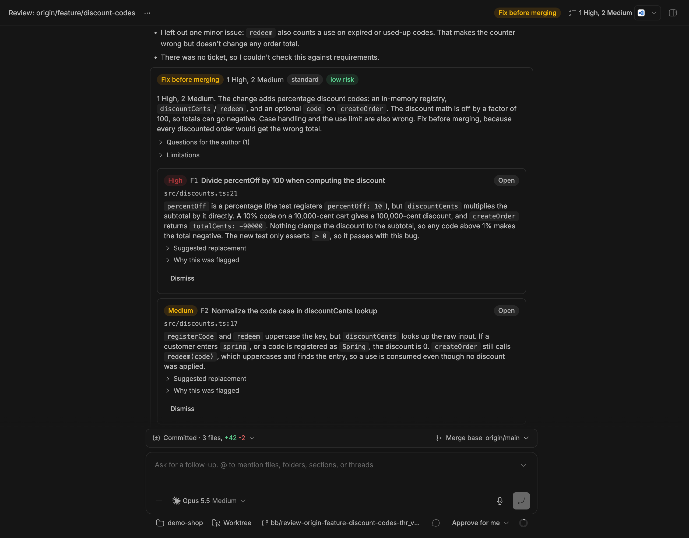
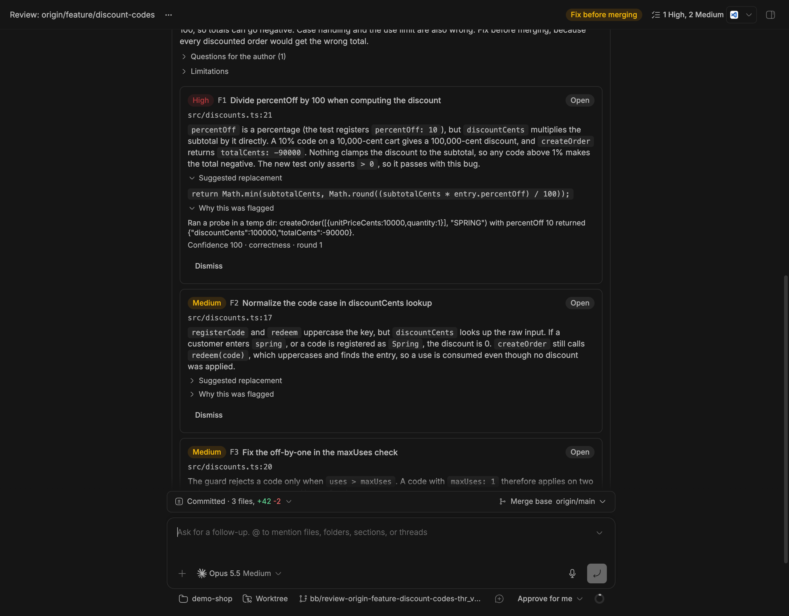
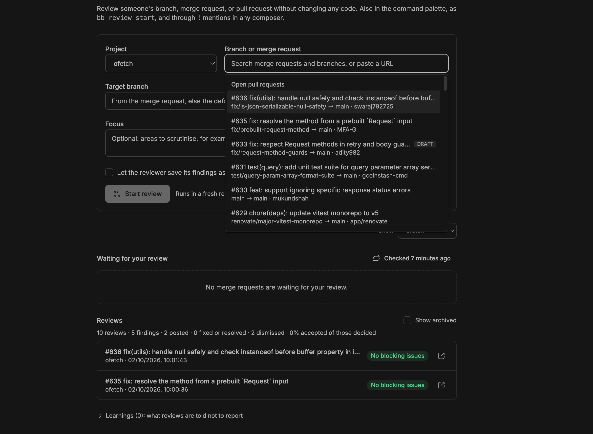

# bb-plugin-review

Review someone's branch, GitLab merge request, or GitHub pull request in bb without implementing anything, then post, track, and re-review the findings.



<p>
  
  
</p>

The screenshots show a synthetic demo repository and public pull requests of [unjs/ofetch](https://github.com/unjs/ofetch).

## What happens when you start a review

1. **Fetch.** On the project's machine, the plugin fetches the change and its target branch. It reads merge request metadata with `glab` (`gh` for GitHub) when those are installed and logged in.
2. **Analyse.** It measures size and risk, reads the dependency changes, and matches path rules. It finds the ticket key and fetches the ticket when Jira is configured, and collects the existing review comments.
3. **Isolate.** It starts a thread in a new worktree at the change's head commit, so your checkout is never touched. The worktree branch has no upstream, so an accidental `git push` fails. bb's diff panel compares against the target branch.
4. **Review.** The agent runs in Plan mode, which blocks file edits. It follows the review guidelines and reports through the `present_review` tool. That tool only displays the result, so it is allowed in Plan mode. If the agent writes the report as text instead, the plugin parses it.
5. **Follow up.** When configured, the plugin runs your checks in the worktree, starts a UI preview, and asks a second reviewer on another model. Each result arrives in the thread as a message.

## Using it

**Reviews page** (sidebar → Reviews):

- **Start a review.** Pick the project, then search open merge requests and branches. Picking a merge request fills in its target. Then choose a depth.
- **Waiting for your review.** Lists merge requests where you are a reviewer, with Review and Re-review buttons. This is refreshed every 10 minutes. The sidebar badge counts the ones that need you.
- **Reviews.** Each review shows its verdict, counts, risk, round, check status, and whether there are new commits. Use **Show archived** to include old reviews.
- **Learnings.** Lists what future reviews are told not to report.

**In a review thread:**

- **The header** shows the verdict and the open counts. It has **Findings** and, when there are new commits, **Re-review**.
- **Findings** opens the review panel. The report message also ends with the same interactive cards.
  - Each card shows severity, status, a clickable `file:line`, the suggested replacement, and "why this was flagged" (evidence and confidence).
  - Select findings → **Save as draft review**. They become GitLab draft notes (or a pending GitHub review), anchored to the diff lines, with a summary comment. Nothing is visible to others until you **Publish**, either here or on GitLab.
  - **Dismiss** takes an optional reason. With **Remember**, the reason becomes a learning for future reviews.
  - **Sync** picks up resolved threads, drafts you deleted on GitLab, the merge request's state, and new commits.
- **Re-review** moves the worktree to the new head. The reviewer then:
  - marks earlier findings as fixed, still open, or obsolete
  - reviews only the new commits
  - reports only Critical and High findings, so rounds converge

**Command palette** (Mod+Shift+P):

- Review a branch or merge request…
- Show review findings
- Re-review this merge request's new commits

**Composer:** type `!` to pick an open merge request and attach its details to any message.

**CLI and agents:**

```bash
bb review start '!123' --project my-app [--into develop] [--depth quick|standard|deep] [--focus "…"] [--post]
bb review findings [thread]                 # F1, F2, … with status
bb review post [thread] [--findings F1,F3] [--publish]
bb review publish [thread]
bb review again [thread]                    # re-review after new commits
bb review dismiss F2 [thread] --reason "…" [--remember]
bb review sync [thread]                     # without a thread: the whole queue
bb review queue [--refresh]
bb review list [--project …] [--archived]
bb review stats
bb review learnings list|add|remove
bb review guidelines                        # the method, for reviewing inside any thread
```

Inside a review thread, the thread argument defaults to that thread.

| Source | Meaning |
| --- | --- |
| `feature/x`, `origin/feature/x` | A branch on the configured remote; an open MR or PR for it is looked up. |
| `!123`, GitLab MR URL | A GitLab merge request. Fork MRs are fetched through `refs/merge-requests/<iid>/head`. |
| `#123`, GitHub PR URL | A GitHub pull request. Fork PRs are fetched through `refs/pull/<n>/head`. |
| `123` | Merge request or pull request; the forge comes from the remote URL. |

The target branch is resolved in this order: `--into`, then the merge request's target, then the remote's default branch.

## Depth

| Depth | What the reviewer does |
| --- | --- |
| `quick` | Only Critical and High correctness or security issues it can verify directly. No subagents, short report. |
| `standard` | The full guidelines. |
| `deep` | Parallel subagents by dimension, a fresh verifier per candidate, and a walkthrough. Also runs the checks, preview, and second opinion when the settings below say `deep`. Reasoning is set to high. |

## Settings

Settings are in Settings → Installed plugins → Review, or available through `bb plugin config review`.

| Setting | Default | |
| --- | --- | --- |
| Git remote | `origin` | Remote to fetch from. |
| Read-only enforcement | `plan` | `plan` uses Plan mode. `guarded` skips it and relies on the instructions, the removed upstream, and a check for uncommitted changes after every turn. |
| Default review depth | `standard` | |
| Team review criteria | | Added to every review. |
| Per-project configuration | `{}` | JSON, see below. |
| Run configured checks / Start configured UI preview / Ask a second reviewer | `deep` | `never`, `deep`, or `always`. |
| Second reviewer provider / model | empty | For example `codex`. Empty disables second opinions. |
| Inspect new packages | on | `npm view` install scripts of added packages; `osv-scanner` when installed. |
| Watch my review requests | on | Sweep every 10 minutes. |
| Start reviews automatically | off | Starts a review for every new review request that is not a draft. |
| Archive reviews of merged or closed merge requests | on | Archived threads stay searchable; bb removes their worktrees. |
| Jira URL / account email / API token | empty | Enables ticket compliance. The token is stored as a secret. |
| Ticket key pattern | `(?<![A-Za-z0-9])[A-Z][A-Z0-9]+-\d+(?!\d)` | Matched against the source branch, title, and description. |

### Per-project configuration

The configuration is keyed by project name or id. Here is an example for a pnpm and Turborepo monorepo called `my-app`; adjust the commands to your repository:

```json
{
  "my-app": {
    "checks": [
      "pnpm install --frozen-lockfile --prefer-offline",
      "pnpm exec turbo run lint typecheck test --filter=...[{base}]"
    ],
    "checkTimeoutMinutes": 20,
    "preview": {
      "command": "pnpm --filter web dev",
      "url": "http://localhost:3000",
      "baselineUrl": "https://www.example.com",
      "readyTimeoutSeconds": 240
    },
    "rules": [
      { "paths": ["apps/web/src/app/**"], "instructions": "Check server/client component boundaries and translation keys." },
      { "paths": ["packages/ui/**", "!**/*.stories.tsx"], "instructions": "Check accessibility and design tokens." }
    ],
    "criteria": "User-facing strings belong in the translation files; flag hard-coded ones.",
    "riskyPaths": ["**/middleware.*", "apps/web/src/app/auth/**", "infrastructure/**"]
  }
}
```

- **`checks`** run one after another in the review worktree. `{base}` and `{head}` expand to the merge base and head SHAs. A fresh worktree has no `node_modules`, so install first. Results reach the reviewer as a message, and it treats a failure as a finding only when the change causes it.
- **`preview`** runs in a terminal of the review environment after the checks. Once the URL answers, the reviewer gets instructions to screenshot the affected routes with `bb browser` and compare them with `baselineUrl`. This needs the bb desktop app. Stop it with **Stop preview**; archiving the review stops it too.
- **`rules`** apply only to matching changed files. `!` excludes. The repository's own `REVIEW.md` files (each scoped to its directory) and `.gitlab/duo/mr-review-instructions.yaml` are read from the change's head too.
- **`riskyPaths`** replaces the default list of sensitive paths used in risk scoring.

## The review method

The method is in `shared/guidelines.ts`. It merges the original prompt with what public review prompts and tools do well:

- **Codex `/review` rubric** (Apache-2.0): qualifying criteria and comment style.
- **Anthropic Claude Code `code-review` plugin, managed Code Review and REVIEW.md docs:**
  - parallel finders by dimension
  - an independent verification per finding
  - a confidence bar
  - scoped rule files
  - the Pre-existing tier
  - convergence on re-review
  - a cap on nitpicks
- **Anthropic `claude-code-security-review`** (MIT): source-to-sink tracing and false-positive precedents.
- **Anthropic pr-review-toolkit:** silent-failure checklist and behavioural test gaps.
- **Qodo PR-Agent** (MIT): an asymmetric bar, ticket compliance, and effort/risk triage.
- **Greptile and CodeRabbit:** learning from dismissed findings, and path instructions.
- **Cursor Bugbot:** measuring by resolution rate (see `bb review stats`).
- **GitLab Duo:** the `mr-review-instructions.yaml` format.
- **obra/superpowers code-reviewer** (MIT): read-only checkout rules.
- **Google engineering practices** (CC-BY 3.0): reading intent first and reading changed code in full context.

## Development

```bash
npm install
npm test            # node:test with type stripping, tests in test/
npm run typecheck
bb plugin build
bb plugin install . --yes
```

This is a path install: bb loads the plugin from this folder, so the folder must stay where it is. To move it, move the folder and run `bb plugin install . --yes` from the new location. Settings are kept.

After editing:

```bash
npm test && npm run typecheck
bb plugin build
bb plugin reload review
```

New review threads pick up the change. Running threads keep the tools and instructions they started with.

Layout:

- `host.ts` and `host/` run on the project's machine. They call `git`, `glab`, `gh`, `npm`, and `osv-scanner`, and run the checks.
- `server.ts` and `server/` hold:
  - the review service and its state, stored as per-thread plugin metadata
  - the brief, settings, and learnings
  - CLI, RPC, and the agent tool, `configure` selection, and mention provider
- `shared/` holds the finding model, report parser, diff-line mapping, guidelines, and source parsing.
- `app.tsx` and `app/` hold the Reviews page, findings board, thread header, palette commands, and toasts.
